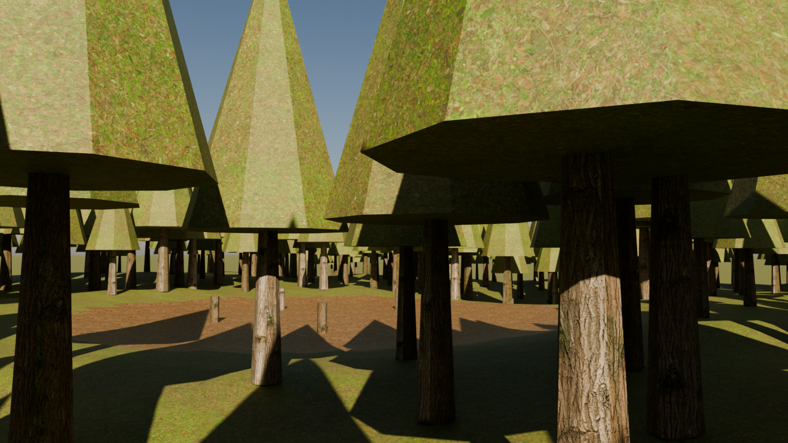
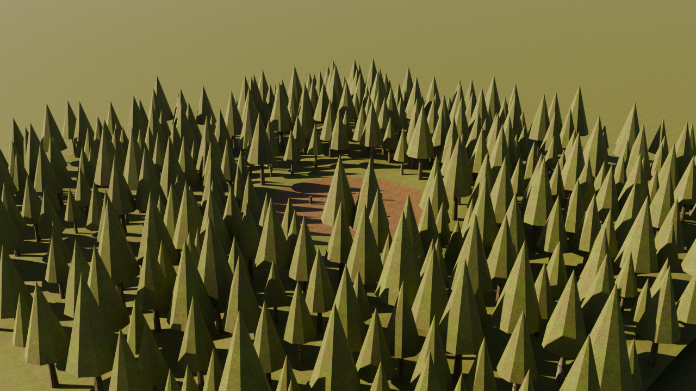

# Level 2 steps 1 and 2: materials by name, and a lighting description (PRO_QUALITY_PLAN B12.2), 2026-10-10

A recipe says `set_material(name="bark")`; the glTF/USD/OBJ exports carry the name; `pt render-scene` (or the MCP tool `render_scene`)
cooks the recipe, checks the scene file, and Blender Cycles renders it with the CC0 PBR set bound to the name by box projection (no UVs).
The scene file holds sky, sun, haze, cameras and quality. Scene: [`scenes/forest_clearing.hcs`](../../../scenes/forest_clearing.hcs) +
[`scenes/forest_clearing.scene.json`](../../../scenes/forest_clearing.scene.json).

The tree shapes are still placeholder cones (shape is the second bottleneck found by the probe); the surface, light and shadow are real.

| Measure | Result |
|---|---|
| Material sets fetched (Poly Haven, CC0, 1k) | 23 sets, 93 files, 50 MB; ledger 169 rows, `pt corpus verify`: 0 problems |
| Render, 1280x720, 96 samples, RTX 2070 SUPER (OptiX) | about 5 s per frame for 49k triangles / 426 objects |
| Scale: 27 884 instances, 2.2 M triangles (quick mode, 2 frames) | 22.8 s including import; exporter switches to `EXT_mesh_gpu_instancing` above 20 000 instances and Blender reads it |
| Same description, same image | CPU: pixel-identical on repeat; GPU: within 1/255, 0.00% of values differ |
| Exposure calibration (18% grey card, `AgX - Medium High Contrast`) | Blender's sun at intensity 1 needs about -5 stops (card at 0.50 for a 45 degree sun, 0.36 at 25, 0.18 at 10); the default base is -4 so scene `exposure: 0` is a sunny day |
| Tests | 154 pass (8 new: material groups, glTF round trip, instances, USD, OBJ, `set_material`, scene check, unknown materials) |

Found and fixed while looking at the pictures: a world-wide fog volume turns the frame black (every shadow ray to the sun is absorbed), so
haze is now a bounded layer; the default exposure was five stops too hot; the dark band above the terrain was the lower half of the sky, so an
endless ground plane is now the default; the eye-height camera landed on the fog box and on tree tops, so it now looks only at the terrain
and the ground; relative output paths were silently lost by Blender, so paths are made absolute.

Sky modes checked: Nishita (default), HDRI (`polyhaven/probe/bloem_hill_01`, overcast light), flat.
