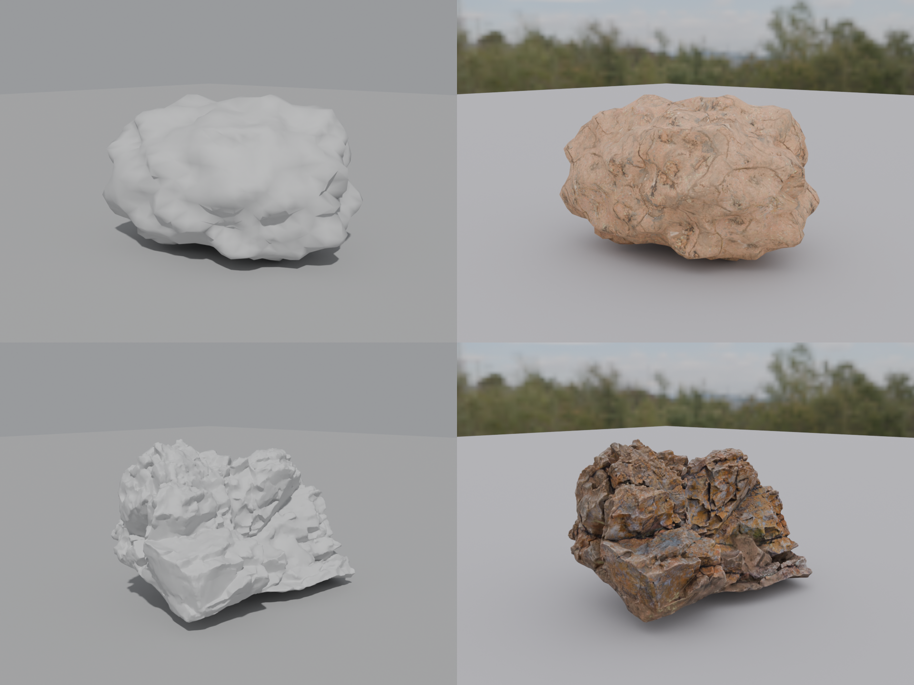

# Realism Probe (B12.1 / gate W0), run 2026-10-10

One question: **how much of the "looks real" gap is appearance (material and light) and how much is shape?**

Layout of `probe.png`: columns = flat grey with plain studio light | real CC0 material under a real CC0 HDRI; rows = our
procedural rock (`recipes/03_rock_generator.hcs`) | a scanned CC0 rock. Same camera, both rocks scaled to 1 m high, same
ground, Cycles (CPU, 64 samples, fixed seed, denoised), Blender 4.5.14. Individual images: `a_ours_flat.png`,
`b_ours_real_material.png`, `c_scan_real_material.png`, `d_scan_flat.png`.

| | Shape | Surface | Light |
|---|---|---|---|
| a (top left) | ours | flat grey | plain studio |
| b (top right) | ours | `rock_boulder_cracked`, box (triplanar) projection, no UVs | `bloem_hill_01` HDRI |
| c (bottom right) | scan `boulder_01` | its own scanned material | same HDRI |
| d (bottom left) | scan `boulder_01` | flat grey | plain studio |

Inputs (all Poly Haven, CC0, recorded in `corpus/LEDGER.csv` with hashes): `boulder_01`, `rock_boulder_cracked`,
`bloem_hill_01`. Script: `corpus/tools/probe_render.py`.

## Reading (the executing agent's eyes, one rock, one view; the owner's judgement overrides)

* **a to b (appearance, ours):** the biggest single jump. Grey clay becomes recognisably stone, with contact shadow,
  sky-coloured reflections and surface variation. At thumbnail size b already passes as a boulder.
* **b to c (shape, with appearance held equal):** still a large gap. Our rock is a smooth, inflated lump: no fracture
  planes, no overhangs, one scale of bumpiness. The scan is angular, layered and multi-scale. The pasted texture in b also
  has no relationship to the geometry (cracks in the picture do not follow cracks in the shape).
* **d (scan, flat grey):** even without any material the scan reads as rock; a is closer to a lump of dough. Shape carries
  a lot of the identity before any colour is added.

**Answer:** neither is negligible. Appearance is the cheapest and most general lift (it applies to every asset we make
and the exporters carry none of it today), so Level 2 steps 1 and 2 (material names bound at render time, lighting
description, B12.2) come first. Shape and multi-scale detail are the second bottleneck and are rock-specific here:
fracture planes and overhangs, i.e. the "detail hierarchy" work in B12.4. The two can proceed in parallel; neither is a
reason to wait for the other.

**Not measured:** this is a visual read, not a metric. The plan's FD_DINOv2 distance to photographs does not exist yet
(Phase 2), so there is no number for "how real". It should be re-run with 3 to 5 rocks, several views and the owner's
blind picks before it decides any budget.
